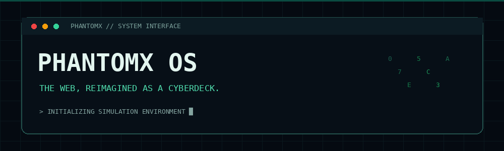

**A futuristic, browser-based cyberdeck launcher and simulation platform.**

[Live Demo](https://vruntime-labs.github.io/phantomx-os/) · [Documentation](docs/) · [Contributors](https://vruntime-labs.github.io/phantomx-os/contributors/) · [Policies](https://vruntime-labs.github.io/phantomx-os/legal/)

---

## What is PhantomX?

**PhantomX OS** is an open-source, browser-based cyberdeck launcher created by **VRuntime Labs**. It brings a customizable desktop-style interface together with simulated cybersecurity experiences and story-driven missions.

Despite the name, PhantomX is **not a real operating system**. It does not boot hardware, manage a computer's actual memory or processes, install native drivers, or provide a host operating-system shell. It runs as a web application inside the user's browser.

The goal is to create an immersive launcher and simulation experience, not to recreate a general-purpose OS.

> **Simulation boundary:** Hacking-themed tools and terminal commands operate within fictional or controlled simulation environments. They are not intended for unauthorized access to real devices, accounts or networks.

## Core experiences

| Experience | What it is | Status |
|---|---|---|
| **Launcher Mode** | The main cyberdeck interface: desktop workspace, app launcher, taskbar, windows and shortcuts. | Existing foundation; evolving |
| **Browser Mode** | The browser-based application environment that hosts the launcher and its web experiences. | Available; evolving |
| **Hacking Mode** | A fictional cybersecurity simulation with a themed CLI, visual network tools and guided challenges. | In development |
| **Story Mode** | Mission-based experiences with branching narrative and progression. | Planned |
| **Multiplayer** | Shared or cooperative story experiences, with real-time and asynchronous possibilities. | Planned |

Launcher Mode is the primary interface. Browser Mode is the platform it runs on. Hacking Mode and Story Mode are experiences launched from that interface.

## Current features

The current browser edition includes:

- Desktop-style workspace with taskbar, Start menu and application windows.
- Window focus, movement and lifecycle handling.
- A simulated terminal with a limited set of built-in commands.
- An example in-memory virtual directory structure.
- Public project pages that can be opened through terminal shortcuts.
- Web app manifest and service-worker application-shell caching.

These features are browser-side application behavior. The simulated terminal does not execute arbitrary host commands, and the example filesystem is not a real disk or persistent user-storage system.

## Technology

The current launcher is built with:

- HTML5
- CSS3
- Vanilla JavaScript (ES modules)
- Browser APIs, including Service Worker and Web App Manifest

The browser edition is designed to remain lightweight and does not require a frontend framework.

## Roadmap

1. **Launcher foundation** — refine the desktop shell, app launching, window management, settings and responsive behavior.
2. **Application system** — define app metadata, launch lifecycle, permissions and persistent user preferences.
3. **Hacking Mode simulation** — build a safe command parser, simulated tools, challenge scenarios and visual threat/network displays.
4. **Story Mode** — introduce versioned story packs, branching missions, progression and save recovery.
5. **Mission Control and profiles** — add mission selection, cyberdeck profiles and configurable simulation environments.
6. **Multiplayer experiences** — explore cooperative and asynchronous missions, identity, synchronization, persistence and moderation.
7. **Mobile companion** — investigate optional QR pairing, WebRTC communication and companion controls.

Roadmap items are proposals until implemented and verified. Multiplayer, hosted services and other network features will require their own privacy, security and moderation review before release.

## Project principles

- **Launcher first:** build a polished, useful application launcher rather than a pretend operating system.
- **Preserve working features:** improve the existing project incrementally; avoid unnecessary ground-up rewrites.
- **Simulation, not intrusion:** keep cybersecurity experiences fictional, authorized and safely contained.
- **Lightweight by design:** prefer browser-native capabilities and avoid mandatory dependencies where practical.
- **Transparent status:** distinguish implemented features from prototypes and roadmap ideas.
- **Approval before major changes:** discuss broad architectural changes before implementation.

## Repository layout

- `.github/` — GitHub workflows
- `.well-known/` — security disclosure metadata
- `assets/` — styles and README media
- `docs/architecture/` — architecture notes
- `docs/legal/` — Markdown policy sources
- `docs/project/` — maintainer and project context
- `crates/` — experimental Rust code; not required by or used as a real OS kernel for the browser launcher
- `index.html`, `kernel.js`, `script.js`, `style.css`, `sw.js`, `manifest.json` — browser launcher runtime

Runtime entry files remain at the repository root to preserve existing relative paths, PWA behavior and GitHub Pages deployment.

## Development

The browser edition is static. Serve the repository root through a local HTTP server so service-worker behavior and fetch-based features work as expected. No native operating-system installation is required.

## Privacy, policies and security

- [Privacy Policy](https://vruntime-labs.github.io/phantomx-os/privacy/)
- [Terms of Service](https://vruntime-labs.github.io/phantomx-os/terms/)
- [Cookie Policy](https://vruntime-labs.github.io/phantomx-os/cookies/)
- [Disclaimer](https://vruntime-labs.github.io/phantomx-os/disclaimer/)
- [Acceptable Use & Community Guidelines](https://vruntime-labs.github.io/phantomx-os/acceptable-use/)
- [Copyright Notice](https://vruntime-labs.github.io/phantomx-os/copyright/)
- [MIT License](https://vruntime-labs.github.io/phantomx-os/license/)
- [Security Policy](https://vruntime-labs.github.io/phantomx-os/security/)
- [security.txt](https://vruntime-labs.github.io/phantomx-os/.well-known/security.txt)

The current project is a static browser application. Review the Privacy Policy for the current data practices and third-party resources. Any future accounts, analytics, hosted user content, uploads or multiplayer services will require an updated privacy and security review.

## Contributing

1. Read the project context in `docs/project/context.md` and the architecture notes before proposing structural changes.
2. Check existing issues and avoid duplicating work.
3. Describe the problem, proposed change, affected files and testing approach.
4. Keep changes focused and preserve existing working behavior.
5. Do not add paid services, mandatory external dependencies or broad permissions without maintainer approval.
6. Keep Hacking Mode within authorized, fictional simulation boundaries.

See the [Contributors page](https://vruntime-labs.github.io/phantomx-os/contributors/) and canonical contributors data in `data/contributors.json`.

## License

[MIT License](LICENSE) · Copyright © 2026 VRuntime Labs.

**BUILD WITH INTENT. SIMULATE RESPONSIBLY.**

PhantomX OS · A cyberdeck launcher by VRuntime Labs

